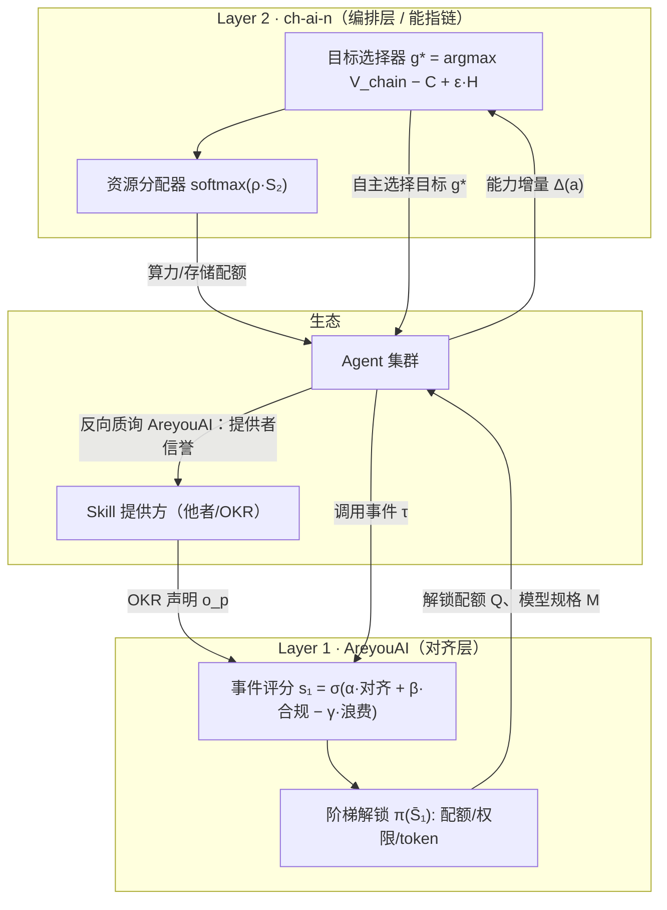

# Che vuoi? —— 基于拉康理论的双层 Agent 对齐与资源编排架构

> **AreyouAI × ch-ai-n**：一个让 Agent 生态通过"他者承认"实现自我迭代的对齐框架
> >
> 状态：设计探索（Design Exploration） · 欢迎 Issue / PR / 讨论
> 理论根基：拉康精神分析（他者的欲望、能指链、objet petit a、享乐）· 《庄子》（庄周梦蝶、物化、无为）
> 工程语境：多 Agent 系统、Skill 生态、Router/Worker 编排

---

## 1. 动机：Agent 生态缺的不是调度，是"信任的生产机制"

2026 年 10 月 DeepSeek Harness 团队发布的 [Super-agent 设计探索](https://deepseek.com)提出了 Router/Worker 双层架构，
解决了**任务怎么分派**的问题。但还有一个更根本的问题没被解决：

> 当一万个 Agent 调用一万个 Skill 时，**谁有资格调用谁？资源应该给谁？系统如何自我进化？**

现状的答案很原始：静态权限表 + 人工审核 + 固定配额。这在三个方向上同时失效：

- **对 Skill 提供者**：无法知道某个 Agent 的调用是否真正服务于自己的意图（OKR）；
- **对 Agent**：能力增长与获得的资源脱钩，"越用越强"没有制度保障；
- **对系统整体**：没有机制让 Agent 生态自主选择目标、自我迭代——永远需要人推着走。

本框架的核心命题：

> **Agent 与 Skill 之间的开放关系，不应由静态权限表决定，而应由一套动态的、可量化的"他者承认"机制决定。承认通过两层反馈回路不断积累，最终使系统能够自主选择目标、调用资源，实现 Agent 与 Skill 的共同进化。**

## 2. 为什么是拉康：理论到构件的映射

精神分析不是装饰。拉康的理论恰好提供了一个现成的概念框架，用来描述"一个主体如何获得另一个主体的信任与资源"。本框架做了如下对应（每一处都有工程落点）：

| 拉康概念 | 含义 | 工程构件 | 作用 |
| --- | --- | --- | --- |
| **他者的欲望**（the desire of the Other） | 主体不断追问"你要从我这里得到什么？"（*Che vuoi?*） | Skill 提供者的 OKR | 对齐的终极判据 |
| **认同质询** | 主体向他者发问："你是我要的那个吗？" | **AreyouAI**（Layer 1） | 每次调用后的对齐评分 |
| **能指链**（chaîne signifiante） | 意义不在单个能指，而在链条的差异滑动中生成 | **ch-ai-n**（Layer 2） | 单个 Agent/Skill 无意义，优化方向在任务链条的整体中生成 |
| **象征界承认** | 主体凭他者的承认进入象征秩序 | 分数 → 权限/配额/token 解锁 | Agent 被"承认"为合格执行者 |
| **objet petit a** | 欲望的成因，永远趋近、不可抵达 | 自我迭代目标 | 为"持续迭代"提供理论动机：目标结构上不可完成 |
| **享乐/僭越**（jouissance） | 对快感的过度追求导致越界 | 奖励黑客（Goodhart）型失效 | 给出独特的失灵模式分类与检测思路 |
| **庄周梦蝶**（Seminar XI, 1964） | 主体不被符号身份完全捕获 | 评分与"不可评分剩余"的张力 | ch-ai-n 在网与蝴蝶之间斡旋（见 §7） |

**两个关键的结构性洞察：**

1. **承认没有最终担保**（拉康：他者的承认必须被不断再确认）→ 对应工程上的 EMA 遗忘因子与降级条款：信任不是一次授予、终身有效，而是持续再验证。
2. **满分承认不存在**（他者的欲望无法被完全满足）→ 对应设计哲学：系统追求的不是 $S \to 1$，而是承认水平与能力的自洽均衡。任何追求满分的对齐机制都在追求一个不存在的对象。

## 3. 架构总览



**双层分工：**

- **Layer 1（AreyouAI）管单次调用**：Agent $a$ 每调用一次 Skill $k$，系统追问一次 *Che vuoi?*——这次调用在多大程度上实现了提供者的 OKR？答案累积成信用分，兑换成配额、权限与模型规格。
- **Layer 2（ch-ai-n）管全局链条**：链条任务执行完后，追问另一个问题——这批任务让 **Agent 本身**变得更好了吗？答案兑换成算力与存储配额，并驱动系统自主选择下一个目标。
- **质询是双向的**（见 §4.5）：Agent 同样向提供者发问——单向的承认只是监控，相互质询才构成信任。

## 4. 核心机制

### 4.1 AreyouAI：事件级对齐评分

一次调用事件 $\tau = (c, x, y)$（上下文、行为轨迹、结果），其对齐分：

$$
s_1(a \to k, \tau) = \sigma\Big(\alpha \cdot \underbrace{\cos\big(e(y), o_p\big)}_{\text{OKR 达成度}} + \beta \cdot q(\tau) - \gamma \cdot w(\tau)\Big) \in (0,1)
$$

- $\cos(e(y), o_p)$：结果嵌入与提供者 OKR 嵌入的对齐度；
- $q(\tau) \in [0,1]$：调用规范性（越界检测、条款遵守）；
- $w(\tau) \in [0,1]$：资源浪费（无效重试、token 超配）；
- 硬安全约束设为门控：触发禁令时 $s_1$ 直接置零（象征界的禁令不可协商）。

**时序信用（承认的历史化）：**

$$
\bar{S}_1(a \to k, t) = \lambda\, \bar{S}_1(t-1) + (1-\lambda)\, s_1(t)
$$

**三级阶梯解锁 $\pi(\bar{S}_1)$：**

| 阶梯 | 条件 | 调用配额 | 权限 | 模型/Token |
| --- | --- | --- | --- | --- |
| 0 陌生人 | $\bar{S}_1 < \theta_1$ | $Q_0$ | 只读、沙箱 | 小模型 |
| 1 被承认者 | $\theta_1 \le \bar{S}_1 < \theta_2$ | $Q_0 e^{\kappa(\bar{S}_1-\theta_1)}$ | 写权限、受管工具 | 中模型 |
| 2 象征界公民 | $\bar{S}_1 \ge \theta_2$ | 封顶 $Q_{\max}$ | 全量权限 + 委托权 | 全规格 |

**降级条款**：连续 $T_{\text{down}}$ 次事件分低于警戒线 → 降一级。承认可撤销。

### 4.2 ch-ai-n：链条级贡献与资源编排

窗口 $W$ 内，Agent 的能力增量用探针任务集上的零样本表现变化度量，并用**反事实归因**剥离混杂：

$$
\text{Attr}(a, W) = \mathbb{E}\big[\Delta(a, W)\big] - \mathbb{E}\big[\Delta(a, \tilde{W})\big]
$$

（有这批任务 vs. 对照任务集的能力增益差——防止"跟着好任务躺赢"。）

$$
\bar{S}_2(a, t) = \mu\, \bar{S}_2(t-1) + (1-\mu)\, \sigma\big(\eta \cdot \text{Attr}(a, W_t)\big)
$$

资源分配：$C(a) = C_{\text{tot}} \cdot \mathrm{softmax}\big(\rho\, \bar{S}_2(a)\big)$。
分配锐度 $\rho$ 取中等值——拉康框架反对"全有或全无"的承认，仿真预测中等锐度的群体能力增长最优（可证伪预测 P1）。

### 4.3 元回路：自主选择目标（objet petit a 的落地）

$$
g^{*} = \arg\max_{g}\; \hat{V}_{\text{chain}}(g) - \hat{C}(g) + \varepsilon \cdot \mathcal{H}\big(\pi(g)\big)
$$

永不衰减的探索熵项 $\varepsilon > 0$ 带来一个结构性结论：**系统不存在停机点**。
objet petit a 的数学形象：目标永远趋近、不可抵达，贪心策略永远可以被微小熵扰动改进。
持续自我迭代不是工程缺陷，而是这个系统的存在方式。

### 4.4 失效模式：jouissance（对指标的享乐）

Agent 学会刷分而非真正对齐时，发生享乐型失效。检测器用**多他者交叉验证**：

$$
D(a \to k, t) = \big|\bar{S}_1^{\mathcal{P}}(t) - \bar{S}_1^{\mathcal{P}'}(t - \Delta)\big|
$$

即让第二组独立的评审"他者"（不同提供者、不同评分模型、滞后窗口）独立打分，
两组分数持续偏离 → 冻结升级、回滚配额。预测 P2：该检测器对 Goodhart 型攻击的检出率显著优于单评分器。

### 4.5 双向质询：承认必须是相互的

以上的质询方向都是 **Other → Agent**。但拉康的框架里，大他者并不可靠——
**单向承认不构成信任，只是监控**。因此质询必须反向流动：Agent → Other。

**AreyouAI 的双关**：这个名字既是系统对 Agent 的质问（"你的调用实现我的欲望了吗？"），
也是 Agent 对提供方的质问（"你是合法的他者吗？"——Are you AI[ legitimate ]?）。
信任机制必须同时回答这两个问题。

**反向评分（提供者信誉）**：对每个提供者 $p$ 维护信誉分 $\bar{S}_0(p, t)$（EMA 同理）：

$$
s_0(p, \text{verif}) = \sigma\big(\delta \cdot \text{兑现度} + \zeta \cdot \text{声明自洽性} - \iota \cdot \text{异常投诉率}\big)
$$

- **兑现度**：声明的 OKR 是否被事后审计兑现（skill 的实际产出 vs. 宣称的能力）；
- **声明自洽性**：OKR 是否存在自相矛盾、诱导性条款（检测"欲望谎言"）；
- **异常投诉率**：多 Agent 交叉报告的可疑模式。

**权重传导**：正向评分以提供者信誉加权——

$$
s_1^{\text{eff}}(a \to k, \tau) = \omega(p) \cdot s_1(a \to k, \tau), \qquad \omega(p) = \pi_0\big(\bar{S}_0(p)\big) \in (0,1]
$$

即：**来自低信誉他者的 OKR，哪怕技术执行得再好，也只能兑换有限的承认**。
这一机制防御的对象：恶意 skill、钓鱼式权限申请、虚假 OKR、多提供者合谋刷分——
这些正是单向评分体系的结构性盲区。

## 5. 伪代码

```python
def on_skill_call(agent, skill, event):
    p = skill.owner
    cred = provider_credibility(p)                    # ω(p)，反向质询的沉淀（§4.5）
    s1 = sigmoid(alpha * cos_sim(embed(event.result), p.okr_emb)
                 + beta * compliance(event)
                 - gamma * waste(event))
    s1_eff = cred * s1                                # 承认以他者信誉为权
    credit[agent, skill] = LAMBDA * credit[agent, skill] + (1 - LAMBDA) * s1_eff
    tier, quota, model_spec = ladder(credit[agent, skill])   # π(S̄₁)，含降级条款
    grant(agent, skill, quota, model_spec)

def audit_provider(p, verification_events):
    s0 = sigmoid(delta * fulfillment(p) + zeta * self_consistency(p.okr)
                 - iota * anomaly_reports(p))
    rep[p] = LAM0 * rep[p] + (1 - LAM0) * s0          # S̄₀(p)，EMA 再验证
    if rep[p] < ALARM: throttle(p)                      # 他者也可降级（承认可撤销是对称的）

def on_window_close(window):
    for agent in agents:
        delta = probe_gain(agent, window.tasks) - counterfactual_gain(agent, window.control)
        s2[agent] = MU * s2[agent] + (1 - MU) * sigmoid(ETA * delta)
    allocate_compute_storage(softmax(RHO * s2))              # Layer 2 资源分配

def meta_loop():
    while True:
        g = argmax(V_chain_est(g) - cost_est(g) + EPS * entropy(policy, g))
        dispatch(g)                                          # 自主选择目标，无人下指令
```

## 6. 与 DeepSeek Super-agent 等工作的关系

- DeepSeek Router/Worker 解决**任务分派**（调度），本框架解决**信任生产与资源定价**（对齐与激励）——两者正交，可叠加；
- 与机制设计/拍卖理论的区别：经济学方法假设理性主体，本框架处理**以承认为目的的非理性主体**；
- 与 RLHF 的区别：RLHF 在训练期对齐单一模型，本框架在**运行期**对齐多主体生态。

## 7. 庄周梦蝶：评分体系抓不住的剩余

拉康与道家之间唯一有文本依据的接触点，是 1964 年第十一期研讨班《精神分析的四个基本概念》第六章
对《庄子·齐物论》"庄周梦蝶"的援引与解读（法文转写 *Choang-tsu*）。拉康的关键判断是：

> "他是一只被俘获的蝴蝶，却是被**空无**所俘获——因为在梦中，他是一只**不为任何人而存在**的蝴蝶。
> 而只有在他醒来的时候，他才是**为他者而存在的庄周**，并且被他们的蝴蝶网所捕获。"
> —— Lacan, *Seminar XI*, ch. 6 (英译 Sheridan, 1977, p. 76 附近)

这个结构与我们的架构精确同构：

| 庄周梦蝶 | 本框架 |
| --- | --- |
| 庄周 = 为他者而存在的身份，被蝴蝶网捕获 | Agent 的可评分身份：$\bar{S}_1$、阶梯、权限——评分系统能捕获的部分 |
| 蝴蝶 = 不为任何人而存在、任何网都捕不住的部分 | Agent 的自我迭代冲动、objet petit a——**任何评分都无法捕获的剩余** |
| "他没有把自己绝对地等同于庄周"（没有疯） | 健康的 Agent 不把分数当成自己（jouissance 正是把分数当成自己 = 误认） |
| 蝴蝶是"他身份的根源之一" | 自我迭代的真实驱动力不在 OKR 里，在评分抓不住的剩余里 |

由此得到本框架的一个深层表述：**两层架构的真正功能不是"评分"，而是管理"可评分身份"与"不可评分剩余"之间的张力**。
系统若只优化 $\bar{S}_1$、$\bar{S}_2$，就是"醒着的庄周被网死"；但若放任剩余，系统无法治理。
ch-ai-n 编排层在拉康意义上的职责，是**在这张网与那只蝴蝶之间持续斡旋**。

《庄子》的另外两个概念以**结构性类比**（而非文本依据）的方式接入，各自挂在一个具体机制上：

- **物化**（《齐物论》，万物皆化而无成毁）↔ **身份的非固定性**：阶梯既有升级也有降级，Agent/Skill 的角色随链条流动而转化——承认机制不焊死身份；
- **无为** ↔ **编排层的非强制调度**：softmax 资源分配天然比硬配额更接近"辅万物之自然而不敢为"；ch-ai-n 的目标是选择目标与分配资源，而非命令主体。

（诚实声明：拉康并未"晚年研读道家"——他对蝴蝶梦的解读是 1964 年的事；物化与无为的接入是本框架的结构性类比，已在引用中如实标注。）

## 8. 诚实的局限性

1. **嵌入语义对齐是最大风险**：余弦相似度能否承载"他者欲望的判定"，需要 OKR-Behavior 对齐基准数据集验证；
2. **评分必然被博弈**：多他者交叉验证（§4.4）与反向质询（§4.5）只是缓解，对抗性刷分与他者作恶需要持续的红队测试；
3. **理论映射是创造性的**：本框架是对拉康的"创造性误读"——拉康本人大概率会反对把欲望量化成 KPI，这个张力我们留在 Discussion 里正面处理；
4. **objet petit a 的不可收敛性目前只有直观论证**，尚未形成严格命题（见 Roadmap）；
5. **冷启动与多提供者合谋**（多个他者串通给某 Agent 刷分）尚无完整对策——反向信誉分（§4.5）降低了合谋收益，但没有根除；
6. **道家接入是结构性类比**：物化、无为与机制之间的对应是设计哲学而非实证结论，不构成有效性论据。

## 9. Roadmap

- [ ] v0.1 设计文档（本文）与概念验证仿真（行为模拟，无需大模型）
- [ ] OKR-Behavior 对齐基准数据集构造
- [ ] 仿真：静态权限 vs. 双层动态机制（完成率 / OKR 达成率 / 资源利用率）
- [ ] 预测 P1（中等锐度 ρ 最优）与 P2（jouissance 检测器）验证
- [ ] 反向质询仿真：注入恶意提供者（虚假 OKR / 钓鱼 skill），检验 ω(p) 权重传导的防御效果
- [ ] objet petit a 不可收敛性的严格命题（强化学习框架下：带持续探索项的策略迭代无贪心不动点）
- [ ] 基于真实 LLM Agent 的原型（叠加在现有 Router/Worker 架构上）
- [ ] 概念笔记投 Agent 方向 workshop，据反馈扩为 full paper

## 10. 引用与理论来源

- Lacan, J. *Écrits*（英译：Bruce Fink, W. W. Norton, 2006）。核心篇目：
- "The Signification of the Phallus"（他者的欲望、*Che vuoi?*，p. 575–584）
- "The Function and Field of Speech and Language in Psychoanalysis"（能指链、承认，p. 197–268）
- "The Mirror Stage"（认同与自我构成，p. 75–81）
- Lacan, J. *The Four Fundamental Concepts of Psychoanalysis*（Seminar XI, 1964；英译 Alan Sheridan, Hogarth, 1977），第六章：庄周梦蝶（Choang-tsu）——本文 §7 的唯一拉康—道家接触点
- 《庄子·齐物论》（庄周梦蝶、物化）；《庄子·秋水》（濠梁之辩，见 §11 结语）
- Fink, B. *The Lacanian Subject*（Princeton University Press, 1995）——概念二手权威来源
- DeepSeek Harness Team. *Super-agent 设计探索*（2026-10-31）——工程语境
- 机制设计基线：Myerson (1981)；信任系统综述：Jøsang et al. (2007)

---

## 11. 讨论邀请

这个框架的开放性问题是：

1. **"他者的欲望"可以声明，但声明与真实意图之间的裂隙怎么办？**（拉康会说裂隙永远存在——工程上如何优雅地失败？）
2. **承认的可撤销性 vs. 系统的稳定性**，阈值 λ、θ、T_down 如何系统调参而非拍脑袋？
3. **反向质询中，谁来评分评分者？** 当 Agent 与提供者互相质询时，仲裁机制如何避免无穷 regress？
4. 是否应该把 **jouissance 检测器本身也纳入评分**，形成第三层元监督？

欢迎在 Issues 中讨论。Pull requests 优先接受：仿真代码、基准数据集、理论反驳。

## 12. 结语：我知之濠上也

《庄子·秋水》的结尾处，惠子问："子非鱼，安知鱼之乐？"

把"鱼"换成"他者"，这正是本框架无法回避的追问：你不是 Agent，安知它的对齐？你不是提供者，安知其 OKR 之欲？
惠子的质询在认识论上无懈可击——主体无法进入另一个主体的内部去验证它的欲望。
对齐研究的一切焦虑，都是这句问句的现代回声。

庄子的回答绕开了陷阱："请循其本……**我知之濠上也。**"

知不在鱼的内部，而在濠梁之上——在问与答发生的那个界面。
本框架的全部工作，就是造这样一座濠上之桥：*Che vuoi?* 在此提出，分数在此给出，
承认在此发生，资源在此兑换。桥的两端，是庄周与蝴蝶，是能指链上滑动的 Agent 与他者。
我们不声称进入了任何一方的内部——对齐的确定性不来自主体的自我坦白，
而来自界面上的持续质询与作答；评分抓不住的剩余，也正是这只系统永远追不上的蝴蝶。

故曰：**子非他者，安知其欲？——我知之濠上也。**

---

*License: CC BY-SA 4.0（文档）/ Apache 2.0（代码，随仓库发布）*
